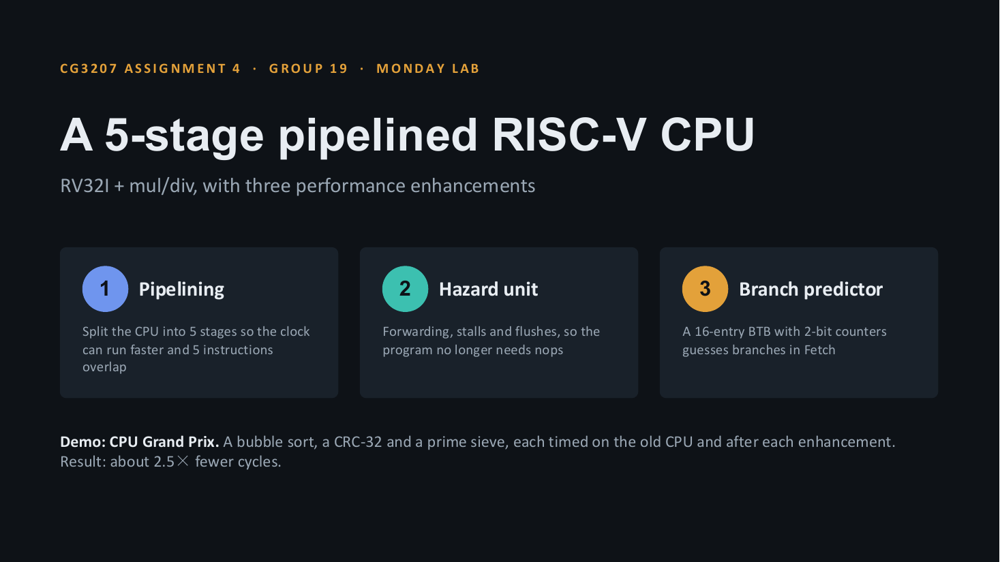
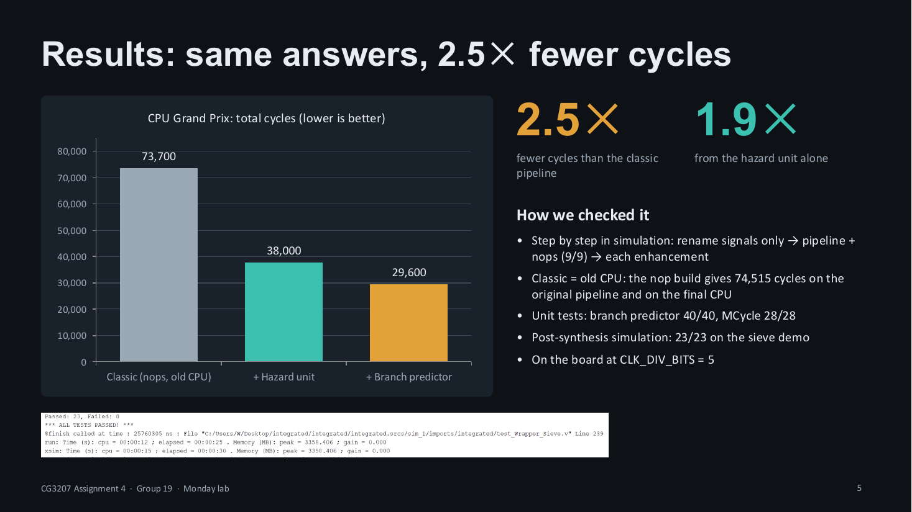
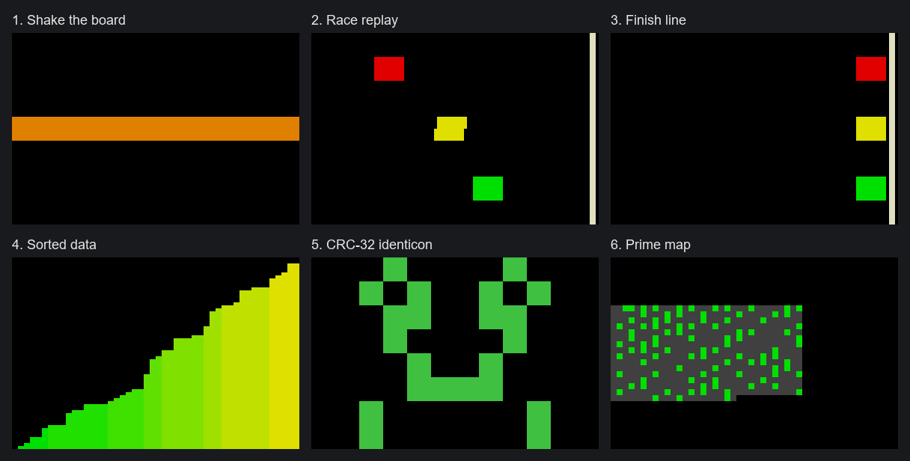
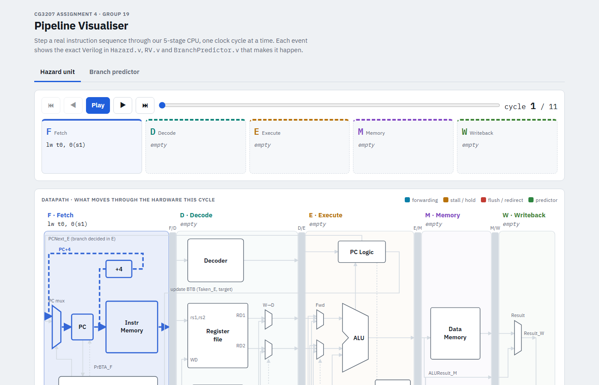
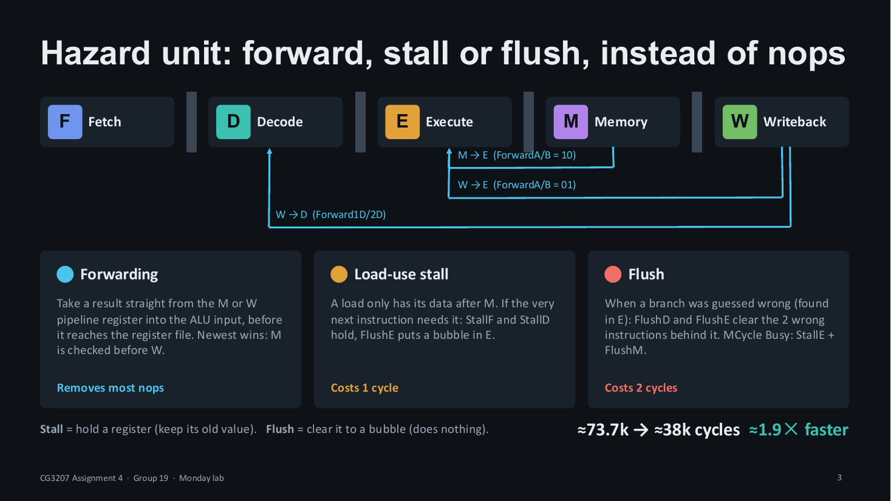
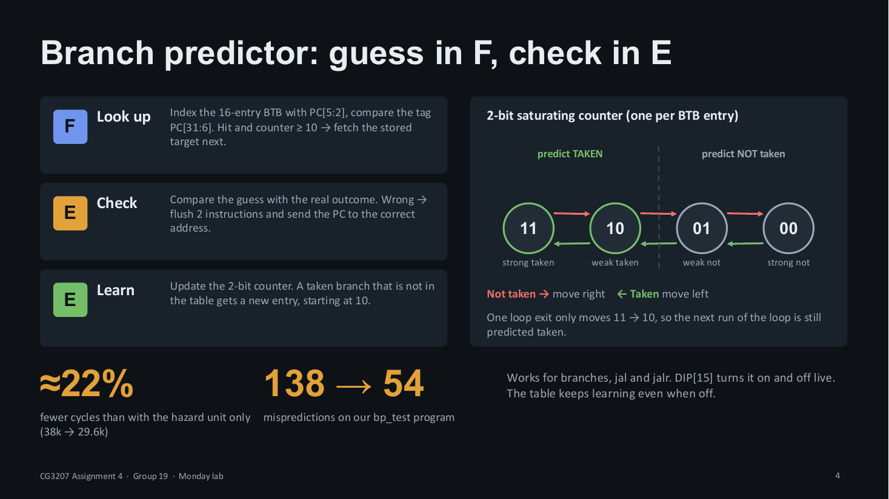

# CPU Grand Prix: a pipelined RISC-V CPU on the Nexys 4

Final project for **CG3207 Computer Architecture** (National University of Singapore), Lab Assignment 4, Group 19.

A 5-stage pipelined RV32I CPU with multi-cycle `mul` / `div` / `divu`, written in Verilog for the Nexys 4 FPGA board, with three performance enhancements:

1. **Pipelining**: five stages (F, D, E, M, W), one instruction finishing per cycle.
2. **Hazard unit**: forwarding, load-use stall and flush, so programs no longer need `nop`s.
3. **Dynamic branch predictor**: a 16-entry branch target buffer with 2-bit saturating counters.

The demo program, the **CPU Grand Prix**, measures all three on the board itself. You shake the board, the CPU runs three benchmarks on the data you made, and the OLED replays the measured times as a race.

## Results

| Benchmark (cycles) | Classic (nops, old pipeline) | + Hazard unit | + Branch predictor |
|---|---:|---:|---:|
| Bubble sort (48 bytes) | 22,957 | 12,604 | 10,062 |
| CRC-32 (48 words) | 27,398 | 14,437 | 11,941 |
| Prime sieve (N = 500) | 23,190 | 10,915 | 7,601 |
| **Total** | **73,545** | **37,956** (1.9×) | **29,604** (2.5×) |

Seed `0x7a6bc2c6`. Sort and CRC change slightly with the shaken data; the sieve does not.

- **Branch predictor microbenchmark** (`bp_test.asm`): 1040 → 872 cycles, mispredictions 138 → 54.
- **Maximum clock**: WNS −5.165 ns at 100 MHz, so the critical path is about 15.2 ns (≈ 65.9 MHz). The path goes from forwarding through the branch compare and target adder to the misprediction flush.
- **Resources** (xc7a100t): 3,810 LUTs, 1,349 flip-flops, 4 BRAM tiles, 0 DSPs (no `*` operator).
- **Proof that "classic" is the old CPU**: the nop-padded build was also run on our original pipeline without hazard hardware. It gives the same results and exactly the same cycle count (74,515) as on the final CPU with the predictor off. The build without nops gives wrong results there.

## The demo: CPU Grand Prix

1. **Shake the board.** The accelerometer readings fill a progress bar and seed a random number generator.
2. The CPU runs three benchmarks on 48 random words: **bubble sort** (load-use hazards, data-dependent branches), **CRC-32** (long dependency chains; the result equals Python's `zlib.crc32`) and a **prime sieve** (tight, predictable loops).
3. Every benchmark runs twice: a **nop-padded build** (3 `nop`s between dependent instructions and 2 after every branch, exactly what the pipeline needed before the hazard unit) and a **build without nops**. Both are timed with the cycle counter and must give the same checksum.
4. The OLED replays the measured times as a race. Each car's speed is inversely proportional to its cycle count. This is a replay of the measurements, not three CPUs running at once.
5. **Flip DIP[15]** to turn on the branch predictor. Everything reruns and a third car joins the race.

### Controls

| Input | Action |
|---|---|
| Shake the board | Make new random data (BTNL skips shaking) |
| BTNR | Next OLED screen: race, sorted bars, CRC identicon, prime map |
| BTNL | Replay the race |
| BTNC | New data (shake again) |
| DIP[15] | Branch predictor on / off |
| DIP[11:10] | Benchmark shown on the 7-segment display: sort, CRC, sieve, total |
| DIP[14:13] | Cycles for classic, + hazard unit, + predictor, or speedup × 100 |
| DIP[12] | Show the benchmark's checksum (hex) instead; for "total", the seed |

**LEDs**: LED0–2 light when both builds give the same result for sort, CRC and sieve. LED3 lights when all three eras have been measured. LED4–5 show the screen number, and LED7 shows the predictor switch.

## Architecture

[`docs/pipeline_visualiser.html`](docs/pipeline_visualiser.html) is a self-contained page that steps through the pipeline one clock cycle at a time and shows the Verilog behind each event.

### Pipeline (`rtl/RV.v`)
- **F**: PC register and instruction fetch; BTB lookup.
- **D**: decoder, register file read (with W→D forwarding), immediate extend.
- **E**: forwarding muxes, ALU, `PC_Logic` (branch decision), `MCycle` (multiply / divide), and a second adder that computes the real next PC to check the prediction.
- **M**: data memory and memory-mapped I/O.
- **W**: result select and register file write.

The next PC is `Mispredict_E ? PCNext_E : (PrTaken_F ? PrBTA_F : PC_F + 4)`.

### Hazard unit (`rtl/Hazard.v`)

| Hazard | Detected when | Action |
|---|---|---|
| Result needed in E | `rs1E/rs2E == rdM` or `rdW` (RegWrite, rd ≠ 0) | Forward from M (newer) or W |
| Register written this cycle | `rs1D/rs2D == rdW` | Forward W → D (same-edge write) |
| Load-use | load in E and `rdE == rs1D/rs2D` | Stall F and D for one cycle, bubble into E |
| Wrong path fetched | misprediction found in E | Flush D and E, redirect the PC |
| Multi-cycle mul / div | `MCycle` busy | Stall F, D and E, bubble into M |

### Branch predictor (`rtl/BranchPredictor.v`)
- 16 entries, direct-mapped and tagged. Each entry holds a target and a 2-bit saturating counter.
- **F**: on a hit whose counter says taken, fetch the stored target.
- **E**: the real outcome is known. On a wrong direction or wrong target (for example a `jalr` returning to a different caller), flush two instructions and correct the PC. Update the entry either way.
- Only taken branches allocate an entry, since a missing entry already predicts "not taken".
- DIP[15] disables prediction (every taken branch then costs a 2-cycle flush), but the table keeps training.

## Repository layout

| Path | Contents |
|---|---|
| `rtl/` | CPU (`RV.v`, `Hazard.v`, `BranchPredictor.v`, ALU, decoder, MCycle, ...), `Wrapper.v` (memories and MMIO) and the board top level / peripherals (`TOP_Nexys.vhd`, UART, OLED, accelerometer) |
| `constraints/` | `TOP_Nexys4.xdc` for the Nexys 4 (non-DDR) |
| `sim/` | Self-checking testbenches |
| `asm/` | `GrandPrix.asm` (demo), `test_Hazard.asm`, `bp_test.asm` |
| `mem/` | Assembled `AA_IROM.mem` / `AA_DMEM.mem` for each program |
| `tools/` | `gen_gp.py` builds `GrandPrix.asm` from `gp_main.s` and `gp_kernels.py`; `pad.py` makes the nop-padded kernel copies |
| `bitstream/` | `TOP.bit`, built from this source and tested on the board |
| `docs/` | Slides (PDF), pipeline visualiser, images |

## Building and simulating

Tested with Vivado 2018.2 on an `xc7a100tcsg324-1` (Nexys 4).

1. Create an RTL project and add everything in `rtl/` as design sources. Add `mem/GrandPrix/AA_IROM.mem` and `AA_DMEM.mem` too, since `Wrapper.v` loads them with `$readmemh` by file name.
2. Add `constraints/TOP_Nexys4.xdc`. The top module is `TOP`.
3. Run synthesis, implementation and bitstream generation. The OLED (PmodOLEDrgb) goes on port **JB**. `CLK_DIV_BITS = 5` in `TOP_Nexys.vhd` runs the CPU at about 1.56 MHz; set it to 0 to time the CPU at 100 MHz.
4. To simulate, add a testbench from `sim/` and set it as the simulation top:

| Testbench | Program (`mem/`) | Checks |
|---|---|---|
| `test_Wrapper_GP.v` | `GrandPrix` | Drives the accelerometer, recomputes sort / CRC / sieve results independently, checks cycle counts, LEDs and OLED pixels: 24/24 (behavioural and post-synthesis). Set the run time to 220 ms. |
| `test_Hazard.v` | `test_Hazard` | 13 hazard cases with no nops, and counts how often each mechanism fires: 13/13 |
| `test_BranchPredictor.v` | none (unit test) | BTB hits, aliasing, counter saturation, enable, stall: 40/40 |
| `test_Wrapper_BP.v` | assemble `asm/bp_test.asm` | Predictor off vs on: 1040 → 872 cycles |

To change the demo, edit `tools/gp_main.s` or `tools/gp_kernels.py`, run `python tools/gen_gp.py asm/GrandPrix.asm` from inside `tools/`, and assemble with [RARS](https://github.com/TheThirdOne/rars) (dump `.text` and `.data` as hexadecimal text).

## Team

Group 19 (Monday lab): Omar (pipelining), Ishaan (branch predictor), Kaiwen (hazard unit, integration and demo program).

## Acknowledgements

The processor and wrapper templates, the peripheral modules and the memory map come from the CG3207 course by Rajesh Panicker (NUS) and keep their original license notices. The course allows students to publish their Lab Assignment 4 only; earlier labs are deliberately not included.
